# Physics-Guided Generative Optimization of Launch-Vehicle Acoustic Liners

Launch-vehicle acoustic treatments must reduce noise around the payload while limiting added mass and occupied space [Stelzer et al., 2025](https://pubs.aip.org/asa/poma/article/57/1/030003/3370464/Designing-and-optimizing-fairing-acoustic). Conventional foam and fiberglass blankets face a tradeoff between thickness and low frequency performance, motivating alternative or complementary treatments for low frequency noise [Hughes and McNelis, 2014](https://ntrs.nasa.gov/api/citations/20140017768/downloads/20140017768.pdf). 

Helmholtz resonators offer passive, geometry-tunable absorption, but introduce their own design challenges ([Estève, 2004](https://vtechworks.lib.vt.edu/items/19a16cc0-214b-4a19-adb7-0ea32c7f72fb), [Dannemann et al., 2018](https://elib.dlr.de/122996/1/applsci-08-01923.pdf), [Genssler et al., 2023](https://elib.dlr.de/195807/1/final_JG_AIAA_watermarked.pdf)). Individual resonators respond most strongly near their tuning frequencies, while targeting lower frequencies can require larger cavities ([Genssler et al., 2023](https://elib.dlr.de/195807/1/final_JG_AIAA_watermarked.pdf)). A useful liner therefore requires coordinated choices: differently tuned resonator families must share limited wall area, fit within the available depth, and provide complementary absorption without exceeding the mass budget ([Estève, 2004](https://vtechworks.lib.vt.edu/items/19a16cc0-214b-4a19-adb7-0ea32c7f72fb), [Manguán et al., 2024](https://www.sciencedirect.com/science/article/abs/pii/S1270963824007211)). 

This project investigates how to navigate these requirements using physics-guided machine learning and evolutionary optimization. A conditional neural generator, referred to as LinerGen, proposes four-bank resonator designs for a specified acoustic environment and under given mass and geometry constraints. CMA-ES (Covariance Matrix Adaptation Evolution Strategy) refines those proposals using a physics-based prediction of noise reduction over eight frequency bands from 50 to 250 Hz. The learned proposals provide a starting point for evolutionary search, with the aim of finding better-performing designs using the same number of physics-model evaluations. 

Selected designs are then examined using finite-element simulations of the fairing's acoustic field and local CFD simulations of amplitude-dependent neck flow. These evaluations examine how predictions change beyond the simplified search model and identify uncertainties that remain. All reported performance is simulation-based. 

## Contents

- [1. Physics Model](#1-physics-model-for-acoustic-liner)
- [2. Design Space](#2-from-physics-to-design-space)
- [3. Generative and Evolutionary Search](#3-physics-guided-generative-and-evolutionary-search)
- [4. FEM Prediction Check](#4-checking-prediction-consistency-with-fem)
- [5. Representative Vehicle Applications](#5-representative-vehicle-applications)
- [6. Conclusions, Limitations, and Next Steps](#6-conclusions-limitations-and-next-steps)
- [7. How to Run](#7-how-to-run)

Looking for the results? Jump to the
[controlled search comparison](#36-controlled-search-evaluation)
or [vehicle outcomes](#55-numerical-sensitivity-and-vehicle-outcomes).

## 1. Physics Model for Acoustic Liner 

### 1.1 Modeling One Helmholtz Resonator

A Helmholtz resonator consists of an enclosed air cavity connected to the surrounding acoustic field through a narrow neck. Sound pressure drives the neck air back and forth while the cavity air compresses and expands. The neck air provides inertia, the cavity air provides a restoring response, and acoustic losses dissipate energy.

The project represents each cell using a lumped acoustic model, where the neck behaves as an acoustic mass and the cavity as an acoustic compliance. This idealization describes the cell through a small number of quantities rather than resolving its internal acoustic field. Such models provide an explicit connection between resonator geometry and tuning ([Dannemann et al., 2018](https://elib.dlr.de/122996/1/applsci-08-01923.pdf)).

Figure 1 shows the idealized cell geometry used by the model. A neck of radius $r$ and physical length $L$ connects the surrounding air to an enclosed cavity of volume $V_c$. These dimensions are used to capture the acoustic mass, compliance, and resonance frequency of the cell.

<figure align="center">
  <a href="docs/figures/readme/fig1_single_resonator_cell.png">
    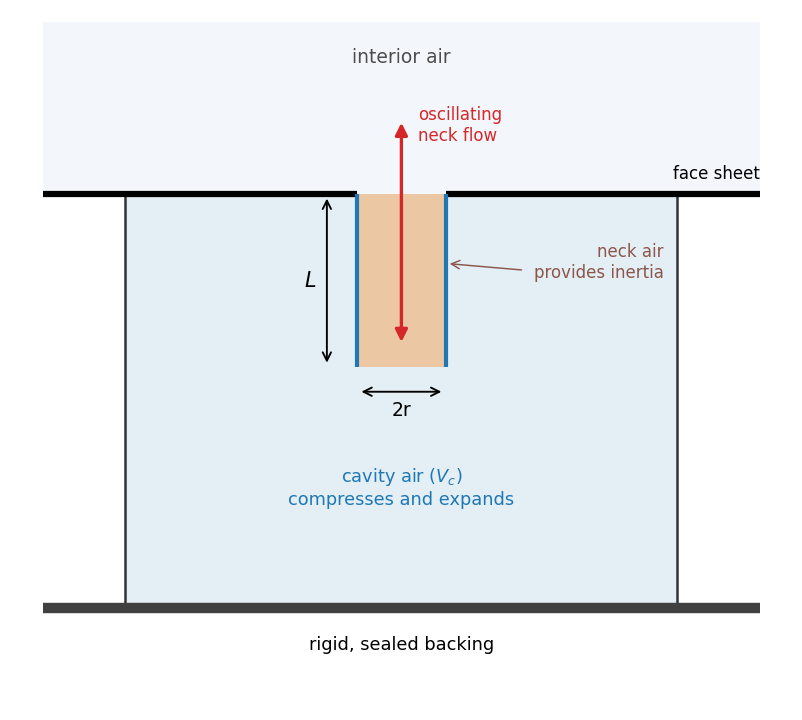
  </a>
  <figcaption><em>Figure 1: Schematic of a single Helmholtz resonator cell.</em></figcaption>
</figure>

For a circular neck with radius $r$ and physical length $L$, the opening area and effective neck length are

```math
S_n=\pi r^2, \qquad L_{\mathrm{eff}}=L+1.7r \qquad (1)
```

The assumed end correction $1.7r$ accounts approximately for air moving just outside the neck openings. The neck’s acoustic mass and the cavity’s acoustic compliance are then

```math
M_a=\frac{\rho L_{\mathrm{eff}}}{S_n}, \qquad C_a=\frac{V_c}{\rho c^2} \qquad (2)
```

where $V_c$ is the cavity volume, $\rho$ is air density, and $c$ is the speed of sound. Acoustic mass describes the neck air's inertia and compliance describes how readily the cavity air compresses. Together, these quantities determine the model’s resonance frequency:

```math
\omega_0=\frac{1}{\sqrt{M_aC_a}} \qquad (3)
```

where the angular frequency $\omega_0$ is measured in radians per second. Dividing by $2\pi$ converts it to the tuning frequency $f_0$ in hertz, or oscillations per second. Substituting the expressions for acoustic mass and compliance gives

```math
f_0=\frac{\omega_0}{2\pi} = \frac{c}{2\pi} \sqrt{\frac{S_n}{V_cL_{\mathrm{eff}}}} \qquad (4)
```

connecting the cell's geometry to its tuning frequency. The resonator cell's response also depends on damping, which is the energy lost from the oscillating air motion. These losses limit the resonant motion and affect the width of its frequency response. Using $\omega_0=2\pi f_0$, the baseline model represents them collectively through an acoustic resistance,

```math
R=\frac{\omega_0M_a}{Q} \qquad (5)
```

The project assumes a quality factor of $Q=15$ for every bank. For fixed geometry, higher $Q$ corresponds to lower resistance and a narrower resonant response. Fixing $Q$ supplies a simplified linear loss model without separately calculating viscous and thermal losses for every geometry. This value is a study assumption. Additional amplitude-dependent neck-flow effects are investigated later using CFD.

To predict the cell’s response to sound, the model then combines resistance, neck inertia, and cavity compliance into its acoustic impedance, $Z_a$. This relates the oscillating pressure at the opening to the volume flow entering the cell. It describes both how much air moves and its phase, which is the timing of that motion relative to the pressure.

```math
Z_a(\omega) = R+\mathrm{i} \left( \omega M_a-\frac{1}{\omega C_a} \right) \qquad (6)
```

Here, $\omega=2\pi f$ is the angular frequency of the sound being evaluated, whereas $\omega_0$ specifies the cell’s tuning frequency. Unlike $\omega_0$, which specifies the cell’s tuning, $\omega$ varies across the sound frequencies being assessed.

The equation separates two effects. Resistance, $R$, represents energy dissipated from the oscillating motion. The term in parentheses is reactance, and it combines the neck air’s inertia with the cavity air’s restoring response. These effects store and return energy, affecting the phase between pressure and flow. The imaginary unit, $\mathrm{i}$, allows this phase-related response to be represented alongside resistance.

At the tuning frequency, the two reactive terms cancel, leaving $Z_a=R$. Pressure and volume flow are then in phase in this model. However, this does not imply complete absorption, as that also depends on how the combined liner response matches the surrounding air.

Cell impedance has units of $\mathrm{Pa\cdot s/m^3}$ and describes one resonator. To calculate the complete liner’s response, the model combines the cells according to each bank’s area share and cell density. This gives the surface impedance used to determine reflection and absorption.

### 1.2 Resonator Banks to Predicted Noise Reduction

To construct the liner, four Helmholtz resonator banks are combined, each consisting of identical cells with its own neck geometry, tuning frequency, and share of the treated area ($a_i$). 

Figure 2(a) and 2(b) connect individual resonator cells to their intended application through a conceptual illustration. As shown in Figure 2(a), the liner occupies a layer along the inside of the fairing wall, with neck openings facing the interior air. The enlarged patch in Figure 2(b) illustrates how differently tuned cells can share this layer. Wall coverage describes how much of the available wall receives treatment, while bank area shares describe how the treated area is divided among the four families.

<figure align="center">
  <a href="docs/figures/readme/fig1-2_liner_in_fairing.png">
    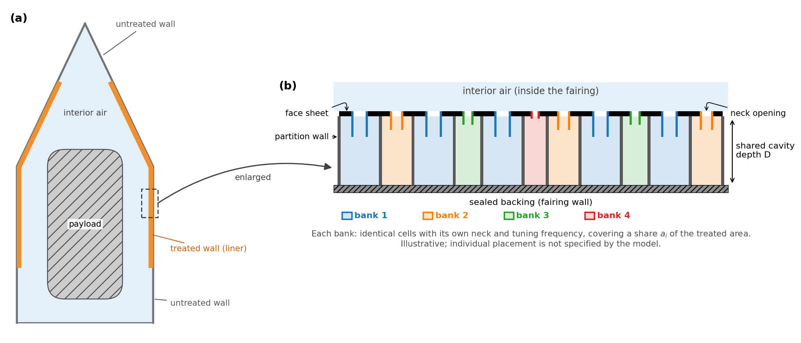
  </a>
  <figcaption><em>Figure 2: From resonator cells to a treated fairing wall. (a) Location of the liner within a representative fairing. (b) Illustrative cross-section of a four-bank liner with shared cavity depth and sealed backing. Colors distinguish resonator families.</em></figcaption>
</figure>

For the acoustic calculation, the banks are assumed to be uniformly mixed over the treated region. Cells exposed to the same local pressure contribute volume flows that add. Under the model’s idealized cavity-volume convention, the number of cells per square meter of treated liner is

```math
n_i=\frac{a_iD}{V_{c,i}} \qquad (7)
```

where $D$ is the shared cavity depth. The bank shares sum to one and describe allocation within the treated region, not the fraction of the entire fairing wall covered.

Since their volume flows add, their cell admittances, which are the reciprocals of their cell impedances ($Z_{a,i}$), combine and are weighted by cell density:

```math
Y_s(f)=\sum_{i=1}^{4}\frac{n_i}{Z_{a,i}(2\pi f)} \qquad (8)
```

Here, $Y_s$ is the combined surface admittance and $n_i$ is the number of cells from bank $i$ per unit treated area. Inverting this total gives the liner’s surface impedance:

```math
z_s(f)=\frac{1}{Y_s(f)} \qquad (9)
```

The resulting surface impedance $z_s$ relates pressure to the average air velocity perpendicular to the treated surface and has units of $\mathrm{Pa\cdot s/m}$. It represents the mixed resonator banks as one continuous acoustic boundary, used to calculate absorption and later in finite-element simulations. This homogenized representation describes the surface’s acoustic response, not the physical arrangement of individual cells.

To determine absorption, the model compares the liner’s surface impedance with the characteristic impedance of air, $\rho c$. It assumes a rigid, sealed backing that prevents acoustic transmission, so incident sound energy is either reflected or absorbed.

For sound arriving at angle $\theta$, measured from the surface normal, the absorption coefficient is

```math
\alpha(f,\theta) = 1-\left| \frac{z_s(f)\cos\theta-\rho c} {z_s(f)\cos\theta+\rho c} \right|^2. \qquad (10)
```

Here, $\alpha=0$ means complete reflection and $\alpha=1$ complete absorption. Normal incidence corresponds to $\theta=0$, meaning sound arrives perpendicular to the surface. The angle-dependent expression assumes a locally reacting liner, where its surface impedance describes the local pressure–velocity relationship without resolving sound propagation between neighboring cells.

Rather than treating all sound as arriving from one direction, the reduced-order model assumes diffuse incidence. It therefore combines the angle-dependent responses into a diffuse-field absorption coefficient:

```math
\alpha_{\mathrm{diffuse}}(f) = \int_0^{\pi/2} \alpha(f,\theta)\sin(2\theta)\,\mathrm{d}\theta. \qquad (11)
```

The weighting $\sin(2\theta)$ accounts for each angular interval’s contribution to the incident acoustic power. Thus, Eq. (10) describes absorption at a particular frequency and arrival angle, while Eq. (11) gives the averaged absorption used by the scorer.

The implementation calculates this response on a fine frequency grid and interpolates to the eight evaluated band centers. These values, denoted $\alpha_{\ell,b}$, are used to estimate the interior noise reduction.

The model estimates the interior noise reduction using a reverberant energy-balance approximation: for fixed acoustic input power, mean-square pressure is inversely proportional to effective absorption area. For available wall area $S$ and treated fraction $\phi$, the effective absorption areas before $(A_{0,b})$ and after $(A_{1,b})$ treatment are

```math
\begin{aligned} A_{0,b} &=S(\alpha_{\mathrm{bare}}+\kappa), \\ A_{1,b} &=S\left[ \phi\alpha_{\ell,b} +(1-\phi)\alpha_{\mathrm{bare}} +\kappa \right] \end{aligned} \qquad (12)
```

Here, $\alpha_{\mathrm{bare}}$ is assumed bare-wall absorption and $\kappa$ represents assumed background absorption. Treatment replaces bare-wall absorption over the fraction $\phi$; it does not change the physical wall area.

The predicted reduction in band $b$ follows from the absorption-area ratio:

```math
\mathrm{NR}_b = 10\log_{10} \left( \frac{A_{1,b}}{A_{0,b}} \right) \qquad (13)
```

A positive band reduction indicates lower predicted mean-square pressure after treatment. A negative value indicates higher predicted pressure, occurring when the modeled liner absorbs less than the bare wall it replaces.

To combine the bands, the model first calculates each band’s share of the source energy:

```math
w_b = \frac{10^{L_b/10}} {\sum_j 10^{L_j/10}}. \qquad (14)
```

Here, $L_b$ is the source level in band $b$, and the denominator sums the energy contributions across all eight evaluated bands. The weights sum to one, so a larger $w_b$ means that band contains a larger share of the evaluated source energy. These weights cover 50–250 Hz, not the complete launch-noise spectrum.

The model then converts each band’s reduction back into a remaining-energy ratio, $10^{-\mathrm{NR}_b/10}$. These ratios are combined using the source-energy weights and converted back to decibels:

```math
\Delta L = -10\log_{10} \left( \sum_b w_b\,10^{-\mathrm{NR}_b/10} \right) \qquad (15)
```

This combines acoustic energies rather than averaging decibel reductions. Improvements in bands containing more source energy therefore have greater influence on the overall result.

The predicted reduction also depends on bare-wall absorption and background loss, which are uncertain modeling inputs. For the same candidate geometry and wall coverage, the model recalculates $\Delta L$ across several prescribed combinations of these inputs. It retains the lowest result as the robust score:

```math
\Delta L_{\mathrm{robust}} = \min_{(\alpha_{\mathrm{bare}},\kappa)\in\mathcal{U}} \Delta L(\alpha_{\mathrm{bare}},\kappa). \qquad (16)
```

Here, $\mathcal{U}$ is the finite set of bare-wall absorption and background-loss settings tested. For example, if the settings predict reductions of 3.8, 3.2, and 2.7 dB, the robust score is 2.7 dB. This is the least favorable prediction within the tested settings, not a guarantee covering every physical uncertainty.

Together, these calculations form the design scorer. For each candidate geometry, it compares wall-coverage choices within the modeled mass limit. Each coverage receives its own robust score, and the scorer selects the coverage with the highest robust score.

## 2. From Physics to Design Space 

The acoustic model describes how a resonator’s geometry determines its response. To use that model for design, it is necessary to decide which quantities the search will choose directly and which will be calculated from them.

Because each bank is intended to absorb sound near a particular frequency, the search chooses its tuning frequency $f_{0,i}$ together with its neck radius $r_i$ and neck length $L_i$. Instead of also choosing a cavity volume independently, the model calculates the volume required for that combination to resonate at the selected frequency. Rearranging Eq. (4) gives

```math
V_{c,i} = \frac{S_{n,i}}{L_{\mathrm{eff},i}} \left( \frac{c}{2\pi f_{0,i}} \right)^2 \qquad (17)
```

The search also chooses a cavity depth $D$, shared by all four banks. Assuming square cavity footprints, each bank's calculated cavity volume then determines its cell size:  

```math
s_i=\sqrt{\frac{V_{c,i}}{D}} \qquad (18)
```

Thus, cavity volume and cell size follow from the selected tuning, neck dimensions, and depth. Larger footprints mean fewer cells fit within a given treated area. The search must therefore also choose how much area to allocate to each bank, while construction thicknesses affect the liner’s modeled mass.

Together, these choices define the 18 independent design variables: 

<table align="center">
  <caption>
    <em>Table 1. The 18 independent design variables and their roles.</em>
  </caption>
  <thead>
    <tr>
      <th>Design variables</th>
      <th>Number</th>
      <th>Role</th>
    </tr>
  </thead>
  <tbody>
    <tr>
      <td>Bank tuning frequencies, f<sub>0,i</sub></td>
      <td align="center">4</td>
      <td>Set the target resonance of each family.</td>
    </tr>
    <tr>
      <td>Neck radii, r<sub>i</sub></td>
      <td align="center">4</td>
      <td>Determine opening areas and affect acoustic mass and required cavity volume.</td>
    </tr>
    <tr>
      <td>Neck lengths, L<sub>i</sub></td>
      <td align="center">4</td>
      <td>Affect effective neck length, acoustic mass, and required cavity volume.</td>
    </tr>
    <tr>
      <td>Independent bank area shares, a<sub>i</sub></td>
      <td align="center">3</td>
      <td>Allocate treated area among four banks; the fourth share follows from
        a<sub>1</sub> + a<sub>2</sub> + a<sub>3</sub> + a<sub>4</sub> = 1.
      </td>
    </tr>
    <tr>
      <td>Shared cavity depth, D</td>
      <td align="center">1</td>
      <td>Converts cavity volume into footprint and affects modeled construction mass.</td>
    </tr>
    <tr>
      <td>Face-sheet thickness, t<sub>face</sub></td>
      <td align="center">1</td>
      <td>Sets the front-sheet thickness and contributes to modeled mass.</td>
    </tr>
    <tr>
      <td>Partition-wall thickness, t<sub>wall</sub></td>
      <td align="center">1</td>
      <td>Sets the thickness of shared walls between cells and contributes to modeled mass.</td>
    </tr>
  </tbody>
</table>

The search limits cavity depth to 50 mm, neck radius to 1–10 mm, and physical neck length to 5–40 mm. Face-sheet thickness ranges from 0.5–2.0 mm, and partition-wall thickness from 0.4–1.5 mm. Additional geometric checks restrict allowable combinations, including requiring the neck length not to exceed cavity depth. These are the given geometric bounds.

The variables must therefore be selected together. A change intended to improve one bank’s response can also change its footprint, cell density, mass contribution, and interaction with the other banks through the combined impedance.

For each candidate geometry, the design scorer selects the treated wall fraction within the installed-mass budget. Coverage is therefore calculated during evaluation rather than included among the 18 independent search variables. The model accounts for face-sheet mass, shared partition-wall mass, and assumed installation allowances.

The objective is to optimize this design space in order to maximize the robust predicted noise reduction, $\Delta L_{\mathrm{robust}}$, defined in Eq. (16), while satisfying the prescribed mass and geometry constraints.

## 3. Physics-Guided Generative and Evolutionary Search

The preceding model connects resonator tuning, neck geometry, area allocation, and construction dimensions to acoustic performance and modeled mass. Finding effective combinations within these constraints requires searching coupled variables. LinerGen learns to propose promising combinations across related design conditions, providing reusable starting points for new searches. CMA-ES then refines those proposals for the current condition using the exact reduced-order scorer defined in Eq (16).

### 3.1 Generating the Training Conditions

LinerGen is trained across different acoustic environments and constraints rather than for one fixed vehicle. The training set contains 2,048 synthetic conditions, each specifying a source spectrum, available wall area, mass budget, assumed background loss, and requested noise reduction. These are design problems, not examples of known optimal liners: the network proposes geometries, and the acoustic model evaluates them during training.

Each synthetic spectrum combines a smooth peak with a frequency-dependent tilt. Changing the peak’s location, width, and height, together with the tilt, changes how acoustic energy is distributed across the eight evaluated bands.

<table align="center">
  <caption>
    <em>Table 2. Parameters used to generate the synthetic acoustic spectra.</em>
  </caption>
  <thead>
    <tr>
      <th align="left">Generation parameter</th>
      <th align="left">What it controls</th>
      <th align="left">Sampled range</th>
    </tr>
  </thead>
  <tbody>
    <tr>
      <td>Peak center</td>
      <td>Location of the spectral peak.</td>
      <td>40–315 Hz</td>
    </tr>
    <tr>
      <td>Peak width</td>
      <td>Spread of the peak across frequencies.</td>
      <td>0.30–1.50 octaves</td>
    </tr>
    <tr>
      <td>Relative peak height</td>
      <td>Height above the underlying tilted spectrum.</td>
      <td>0–15 dB</td>
    </tr>
    <tr>
      <td>Spectral tilt</td>
      <td>Overall rise or fall with frequency.</td>
      <td>−6 to +6 dB per octave</td>
    </tr>
    <tr>
      <td>Highest band level</td>
      <td>Absolute level of the loudest evaluated band.</td>
      <td>120–145 dB</td>
    </tr>
  </tbody>
</table>

The peak center can lie outside 50–250 Hz, but each resulting spectrum is evaluated only at the eight selected band centers. These spectra are generated mathematically rather than taken from individual launch measurements.

Each spectrum is paired with a wall area of 50–200 m², a mass budget of 100–300 kg, and a nominal background-loss parameter $\kappa$ between 0 and 0.30. Varying these constraints presents the network with different design problems, including different allowable masses per unit wall area.

A requested reduction is also assigned to each condition. The acoustic model evaluates a fixed four-bank reference design and estimates its best reduction over wall coverage. The request is set to 30–70% of that estimate, with a minimum of 0.25 dB. This reference establishes a model-based scale for the input, however, it is not a known optimum or a geometry the network is trained to reproduce. Training rewards higher predicted reduction rather than agreement with the requested value.

Latin hypercube sampling distributes the conditions across the prescribed parameter ranges. For the training set, each sampled range is divided into 2,048 equal intervals, with one value drawn from each interval. The values are shuffled across parameters to form different combinations. This balances coverage of each individual range without evaluating every possible combination, but, it does not guarantee uniform coverage of the complete multidimensional space.

A separate set of 128 conditions supports validation and checkpoint selection, not gradient updates. Separate random streams and overlap checks keep these sets distinct from each other and the held-out evaluation conditions.

### 3.2 Network Inputs

Each generated condition is converted into a 13-feature vector describing its acoustic environment and constraints. A separate random vector supplies variation between proposals for the same condition.

<table align="center">
  <caption>
    <strong>Table 3.</strong> Condition features supplied to LinerGen.
  </caption>
  <thead>
    <tr>
      <th align="left">Condition information</th>
      <th align="center">Feature count</th>
      <th align="left">Purpose</th>
    </tr>
  </thead>
  <tbody>
    <tr>
      <td align="left">Source-energy weights across eight bands</td>
      <td align="center">8</td>
      <td align="left">Identify where reduction contributes most to the score.</td>
    </tr>
    <tr>
      <td align="left">Requested noise reduction</td>
      <td align="center">1</td>
      <td align="left">Describe the requested performance level.</td>
    </tr>
    <tr>
      <td align="left">Mass budget</td>
      <td align="center">1</td>
      <td align="left">Specify allowable modeled installed mass.</td>
    </tr>
    <tr>
      <td align="left">Available wall area</td>
      <td align="center">1</td>
      <td align="left">Specify the surface available for treatment.</td>
    </tr>
    <tr>
      <td align="left">Background-loss parameter, κ</td>
      <td align="center">1</td>
      <td align="left">Describe assumed competing acoustic losses.</td>
    </tr>
    <tr>
      <td align="left">Mass budget divided by wall area</td>
      <td align="center">1</td>
      <td align="left">Expose allowable mass per unit area directly.</td>
    </tr>
    <tr>
      <td align="left"><strong>Total</strong></td>
      <td align="center"><strong>13</strong></td>
      <td></td>
    </tr>
  </tbody>
</table>

The source spectrum is represented by normalized energy weights because the linear reduced-order score depends on the relative distribution of energy between bands. Increasing every band by the same number of decibels leaves these weights—and the predicted reduction—unchanged. Absolute source level is therefore not supplied as a separate network feature, however, its role in amplitude-dependent flow is considered later in the CFD evaluation.

Mass, area, and their ratio are logarithmically transformed. Energy weights are multiplied by eight, and $\kappa$ is divided by 0.30. These fixed transformations adjust the numerical representation without using statistics fitted from evaluation data. Mass per unit area is included explicitly to expose a relevant constraint relationship, although it can be calculated from two other inputs.

A deterministic network receiving only the condition vector would return the same proposal each time. To support multiple alternatives, LinerGen also receives a 32-value random vector containing:

- 18 logistic-distributed values, matching the coordinate sampling used by the random-proposal baseline.
- 14 standard-normal values available to the learned network.

To generate several candidates, the same condition vector is paired with independently sampled random vectors. Each pair produces one proposal. This means that a 32-value random vector is one proposal input, whereas 32 proposals require 32 such vectors.

Random inputs do not guarantee distinct outputs because the network can learn to ignore them. The training objective therefore includes a diversity term to discourage near-duplicate designs among similarly high-performing proposals.

### 3.3 Generator Architecture

LinerGen combines the 13-feature condition vector and 32-value random input through a fully connected residual network with four blocks of width 256 and approximately 1.14 million trainable parameters. Its output contains the 18 design coordinates defined in Table 1.

Figure 3 shows how the two inputs influence each proposal. They enter the initial projection together, while a separate condition network supplies scales and shifts to every residual block. The acoustic environment and constraints can therefore influence intermediate calculations, rather than entering only at the beginning. A direct connection also carries the first 18 random values to the output, where the network adds its learned correction.

<figure align="center">
  <a href="docs/figures/readme/fig5b_linergen_network.png">
    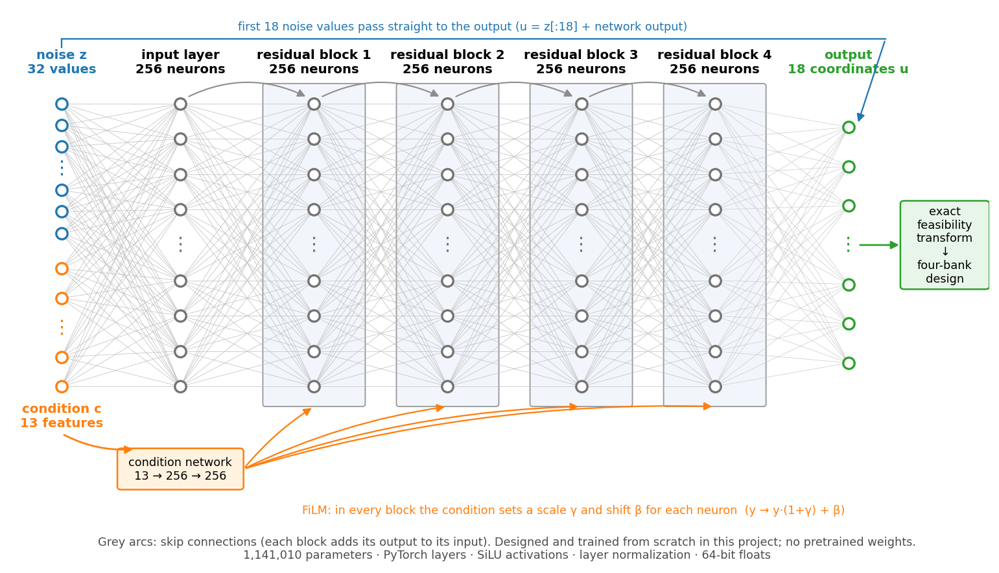
  </a>
  <figcaption><em>Figure 3. LinerGen generator architecture. Orange arrows show condition-dependent modulation of the four residual blocks. Gray arcs indicate residual connections, and the blue path carries the first 18 random inputs directly to the output. Internal connections are schematic; the resulting coordinates are decoded into a four-bank geometry.</em></figcaption>
</figure>

Within each residual block, the network adds an adjustment to its incoming representation. Condition-dependent scaling and shifting modify that adjustment, SiLU (Sigmoid Linear Unit) activations provide smooth nonlinear transformations, and layer normalization normalizes intermediate features.

The output head is initialized to zero, so the untrained generator returns the first 18 random inputs unchanged. For identical random inputs, it therefore reproduces the matched random baseline. Training learns a correction to this starting distribution, allowing the comparison to distinguish learned improvements from differences in initial sampling.

The output coordinates pass through a coordinate-to-design transform that enforces the encoded geometric constraints. Installed-mass compliance is handled separately through wall-coverage selection, rather than guaranteed by the network output alone.

The network width, block count, and random-input dimension were fixed architecture choices, not selected through comparisons of alternatives. With this architecture fixed, training adjusts the network parameters using feedback from the differentiable acoustic model, as described next.

### 3.4 Training Through the Acoustic Model

At each training step, the network receives 16 conditions and generates 16 proposals for each, producing 256 candidates. Their coordinates are decoded into designs, and a differentiable acoustic model calculates absorption, modeled mass, and robust predicted reduction.

Gradients pass backward through these calculations to update the network parameters. Training therefore uses model-calculated performance rather than examples of known optimal designs. FEM and CFD results are not used for training.

The objective balances three terms:

- Acoustic performance: increase mean robust predicted reduction.
- Diversity: discourage near-duplicate designs among similarly high-performing proposals.
- Numerical regularization: discourage extreme coordinates that would saturate the coordinate transform.

For each candidate geometry, training evaluates 26 wall-coverage values between no treatment and the maximum allowed by its modeled mass budget. At each coverage, the score is the lowest predicted reduction across the prescribed acoustic uncertainty settings.

Training emphasizes the best-performing coverage while retaining a learning signal from other coverage levels. This can help improve initially poor geometries even when no treatment currently gives the highest score. The approximation increasingly favors the best-performing coverage as training progresses. Only the coverage comparison is smoothed, and the uncertainty comparison continues to retain the lowest score.

Training uses the Adam optimizer for 200 epochs in double precision. Every five epochs, the network generates 32 proposals for each validation condition. These are evaluated with the exact scorer rather than the smooth training approximation. Checkpoint selection first checks feasibility, mass compliance, and diversity, then favors the highest mean best-proposal score across validation conditions. The released checkpoint was selected at epoch 155.

### 3.5 Design Search with CMA-ES

After training and checkpoint selection, LinerGen initializes a separate design search. Its weights remain fixed: no further training or backpropagation occurs.

The generator supplies a population of candidates that CMA-ES can use to establish an initial search location and spread. CMA-ES then adapts its sampling distribution through further evaluations, connecting reusable learned proposals with condition-specific refinement. Its covariance adaptation supports coordinated changes to coupled variables such as neck dimensions, tuning frequencies, and bank area shares ([Hansen, 2016](https://arxiv.org/abs/1604.00772)).

For a new condition, LinerGen generates 32 initial proposals. The exact scorer evaluates them, and the best eight determine a weighted initial mean and coordinate-wise spread. CMA-ES subsequently samples additional candidates and updates its mean, covariance, and step size toward better-performing regions.

This refinement requires only candidate scores, avoiding differentiation through the exact scorer’s coverage selection and worst-case comparisons. It operates directly in design-coordinate space rather than changing the network’s random inputs, allowing exploration beyond the generated proposals.

Evaluation of the initial proposals counts toward the search budget under the same accounting rules as subsequent candidates. The best design evaluated across both stages is returned, including an initial proposal if refinement produces no improvement.

### 3.6 Controlled Search Evaluation

To evaluate whether learned proposals provide a better starting point for refinement, LinerGen-seeded CMA-ES was compared with random-seeded and multi-start CMA-ES under matched evaluation budgets.

The comparison used 100 held-out synthetic conditions, each evaluated with five paired random seeds. Every method used the same acoustic model, constraints, and evaluation-accounting rules.

<table align="center">
  <caption>
    <em>Table 4. Methods used to distinguish the contributions of learned proposals and evolutionary refinement.</em>
  </caption>
  <thead>
    <tr>
      <th>Method</th>
      <th>Approach</th>
      <th>Purpose</th>
    </tr>
  </thead>
  <tbody>
    <tr>
      <td align="center">A</td>
      <td>Multi-start CMA-ES</td>
      <td>Search baseline without learned initialization.</td>
    </tr>
    <tr>
      <td align="center">B</td>
      <td>Random-seeded CMA-ES</td>
      <td>Uses 32 random proposals and the same initialization procedure as the hybrid.</td>
    </tr>
    <tr>
      <td align="center">C</td>
      <td>LinerGen proposals only</td>
      <td>Returns the best of 32 generated proposals without refinement.</td>
    </tr>
    <tr>
      <td align="center">D</td>
      <td>LinerGen-seeded CMA-ES</td>
      <td>Uses learned proposals to initialize evolutionary refinement.</td>
    </tr>
  </tbody>
</table>

Methods A, B, and D were compared at budgets of 128, 512, and 2,048 unique feasible candidate evaluations. Method C returned the best of 32 learned proposals without refinement. 

LinerGen-seeded CMA-ES achieved a higher mean robust reduced-order score than both search baselines at every evaluated budget.

<table align="center">
  <caption>
    <em>Table 5. Mean paired improvements in the robust reduced-order score, with 95% bootstrap confidence intervals.</em>
  </caption>
  <thead>
    <tr>
      <th>Evaluation budget</th>
      <th>Improvement over multi-start CMA-ES</th>
      <th>Improvement over random-seeded CMA-ES</th>
    </tr>
  </thead>
  <tbody>
    <tr>
      <td align="right">128</td>
      <td align="right">1.050 dB [0.937, 1.165]</td>
      <td align="right">0.904 dB [0.811, 0.999]</td>
    </tr>
    <tr>
      <td align="right">512</td>
      <td align="right">0.743 dB [0.669, 0.819]</td>
      <td align="right">0.458 dB [0.412, 0.505]</td>
    </tr>
    <tr>
      <td align="right">2,048</td>
      <td align="right">0.354 dB [0.313, 0.396]</td>
      <td align="right">0.208 dB [0.174, 0.245]</td>
    </tr>
  </tbody>
</table>

For each condition, the improvement was averaged over five paired seeds. To estimate uncertainty in the overall mean, 10,000 new samples were formed by randomly selecting 100 of these condition averages each time, allowing the same condition to be selected more than once. The middle 95% of the resulting sample means define the bootstrap confidence interval. This interval describes uncertainty in the mean improvement, not how widely individual conditions differ.

Figure 4 shows that learned initialization provides its largest mean advantage at the smallest tested budget. Relative to multi-start CMA-ES, the improvement decreases from 1.050 dB at 128 evaluations to 0.354 dB at 2,048 evaluations. The advantage also remains positive against random-seeded CMA-ES, which uses the same initialization procedure but replaces learned proposals with random ones. All plotted confidence intervals lie above zero, supporting a positive mean improvement at each tested budget, however, this does not imply that the learned method wins on every condition.

<figure align="center">
  <a href="docs/figures/readme/fig4_paired_improvement.png">
    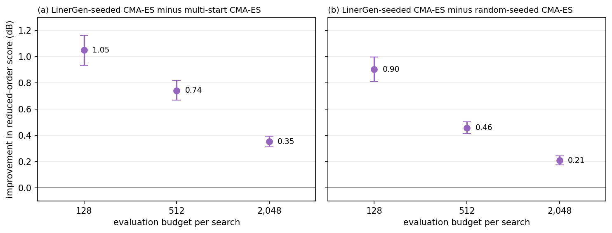
  </a>
  <figcaption><em>Figure 4. Mean paired improvements in robust reduced-order score from LinerGen-seeded CMA-ES relative to (a) multi-start CMA-ES and (b) random-seeded CMA-ES. Markers show means and error bars show 95% bootstrap confidence intervals based on condition-level resampling. </em></figcaption>
</figure>

The shrinking advantage indicates that learned starting proposals were most beneficial at the smallest tested budget, while additional evaluations allowed the baselines to narrow the gap. This supports their use when candidate evaluations are limited, but it does not establish an advantage over fully converged searches.

A separate comparison helps identify where the improvement originated. The best of 32 learned proposals exceeded the best of 32 matched random proposals by an average of 1.424 dB [1.263, 1.586]. A post-hoc descriptive comparison found that subsequent CMA-ES refinement added approximately 0.013 dB on average at 2,048 evaluations. Most of the observed benefit therefore came from the learned proposals, rather than large improvements during refinement.

These results demonstrate improved constrained search within the reduced-order model. They do not establish experimentally validated attenuation or show that the advantage over competing methods persists under FEM. The following section examines whether selected designs retain similar predicted benefits when spatial pressure variations are resolved.


## 4. Checking Prediction Consistency with FEM

The search improves the score supplied to it, but that score depends on a simplified acoustic model. A separate finite-element model examined whether selected designs retained similar predicted benefits when spatial pressure variations were resolved. The designs were evaluated without further optimization.

### 4.1 From a Selected Design to a Pressure Field

The reduced-order scorer estimates the noise reduction defined in Eq. (16) from absorption and a reverberant energy balance. FEM instead calculates the acoustic pressure throughout a specified cavity. The selected design connects these models through the liner’s surface impedance.

LinerGen and CMA-ES supply the resonator geometry and bank area shares, while the scorer selects wall coverage. The cell-impedance, cell-density, and admittance relationships in Eqs (6)-(9) convert the selected geometry into the frequency-dependent surface impedance $z_s(f)$. The network does not predict the pressure field or supply the FEM mesh.

On the treated wall, surface impedance relates acoustic pressure to normal air velocity:

```math
p=z_s(f)\,v_n \qquad (19)
```

FEM applies this relationship as an impedance boundary condition. Internally, the solver uses the dimensionless normalized admittance

```math
\beta(f)=\frac{\rho c}{z_s(f)} \qquad (20)
```

Unlike the reduced-order scorer, FEM uses the complex impedance directly rather than first converting it into diffuse-field absorption.

Inside the cavity, the solver uses the axisymmetric Helmholtz equation:

```math
\frac{1}{r}\frac{\partial}{\partial r} \left(r\frac{\partial p}{\partial r}\right) + \frac{\partial^2p}{\partial z^2} + k^2(1-\mathrm{i}\eta)p = 0 \qquad (21)
```

Here, $p(r,z;f)$ denotes the complex acoustic pressure amplitude at radial position $r$ and axial position $z$, evaluated at frequency $f$. FEM solves for this pressure field separately at each evaluated frequency. Its magnitude describes the amplitude of the pressure oscillation, while its phase describes the timing. The axisymmetric model assumes no variation around the circumference.

The acoustic wavenumber is $k=2\pi f/c$, where $c$ is sound speed. The dimensionless loss factor $\eta(f)$ represents assumed background losses as equivalent damping distributed throughout the air domain.

The reduced-order model represents these losses through the effective absorption area $A_{\mathrm{other}}=\kappa S$. FEM converts that same assumed absorption area into a distributed loss factor:

```math
\eta(f)= C_{\eta}\frac{A_{\mathrm{other}}}{Vf}= C_{\eta}\frac{\kappa S}{Vf}, \qquad C_{\eta}\approx13.66 \ \mathrm{m/s} \qquad (22)
```

Here, $S$ is the available wall area, $V$ is the cavity’s fluid volume, and $f$ is the evaluated frequency. The coefficient $C_{\eta}$ follows from matching a small-loss decay approximation to the Sabine reverberation-time relationship. This is an equivalent representation of assumed background absorption, not an independently measured damping value.

The two loss mechanisms enter FEM differently: $\eta(f)$ acts throughout the air domain in Eq. (21), while the resonator response enters through the wall impedance $z_s(f)$ and its normalized admittance $\beta(f)$.

Figure 5 shows the computational domain and its triangular mesh at nominal mesh size 0.15 m. The full fairing shape is shown, and the meshed half-section represents the air inside an axisymmetric cylinder-plus-cone fairing. A normalized incident wave enters through the base boundary, which also allows outgoing sound to leave. The treated wall receives the liner impedance, while the remaining wall retains the assumed bare-wall response.

Pressure is approximated over the triangular elements, converting Eq. (21) and its boundary conditions into a matrix system solved separately at each evaluated frequency. The enlarged view shows the mesh near the barrel-to-cone junction. Only the air region is meshed. The individual resonator cells and structural vibration of the fairing shell are not resolved.

<figure align="center">
  <a href="docs/figures/readme/fig4-1_fem_domain.png">
    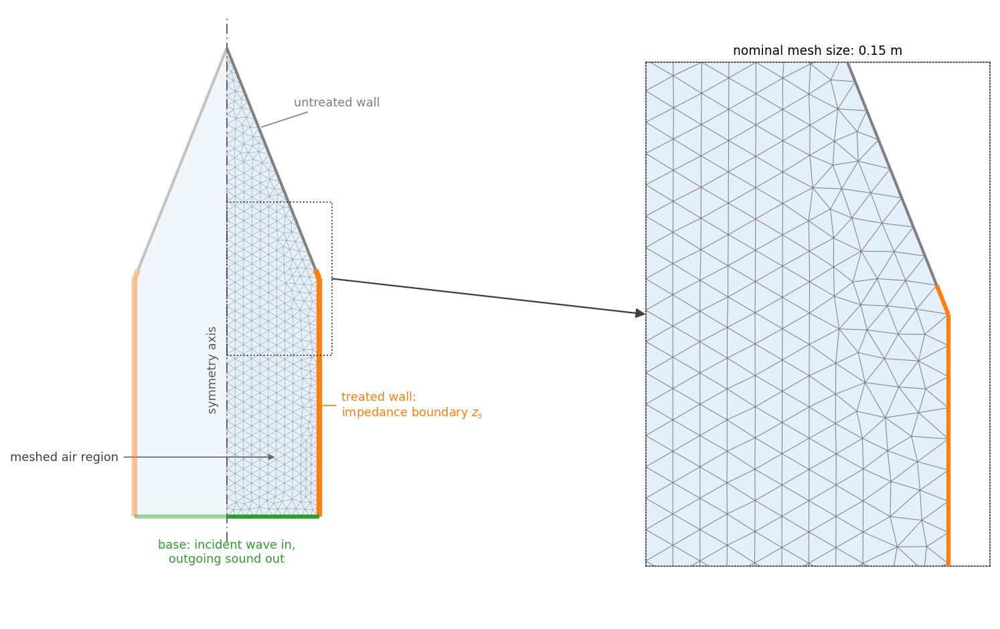
  </a>
  <figcaption><em>Figure 5: Domain of the FEM.</em></figcaption>
</figure>

Solving the mesh-based system gives the complex pressure amplitude throughout the air region at each evaluated frequency. Because pressure varies with position, the model summarizes each field by averaging its squared magnitude over the cavity’s fluid volume. This calculation is performed separately for the untreated and treated configurations:

```math
P(f)=\frac{1}{V}\int_V |p(\mathbf{x};f)|^2\mathrm{d}V \qquad (23)
```

Here, $V$ is the fluid volume and $\mathbf{x}$ denotes position within it. Whereas $p(\mathbf{x};f)$ describes the local pressure response, $P(f)$ summarizes the response across the air domain. Comparing the untreated and treated averages then gives the predicted noise reduction at that frequency:  

```math
\mathrm{NR}_{b,\mathrm{FEM}} = 10\log_{10} \left( \frac{P_{\mathrm{bare}}(f_b)} {P_{\mathrm{treated}}(f_b)} \right) \qquad (24)
```

The band reductions enter the same source-energy-weighted calculation used to obtain $\Delta L$ earlier. Thus, the two models calculate the same type of overall reduction, but obtain their band reductions differently: the reduced-order model uses an absorption-area approximation, while FEM uses spatial pressure solutions.

### 4.2 Applying the Comparison to 20 Additional Conditions

The audit used 20 synthetic conditions separate from training and the final search comparison. For each condition, LinerGen-seeded CMA-ES selected one design using 128 evaluations and random seed 0. Its geometry and selected coverage were then held unchanged during FEM evaluation.

The conditions specify wall area rather than a complete cavity shape. A representative cylinder-plus-cone fairing was therefore scaled uniformly to match each prescribed wall area. These cases contained no payload and used a nominal mesh size of 0.15 m.

Each design was evaluated with two treatment placements, illustrated in Figure 6. In the lower-anchored placement, treatment extends upward from the bottom of the wall. In the upper-anchored placement, it extends downward from the top. Both use the same selected design and prescribed wall-coverage fraction, and only the location of the treated region changes.

<figure align="center">
  <a href="docs/figures/readme/fig4-2_treatment_placement.png">
    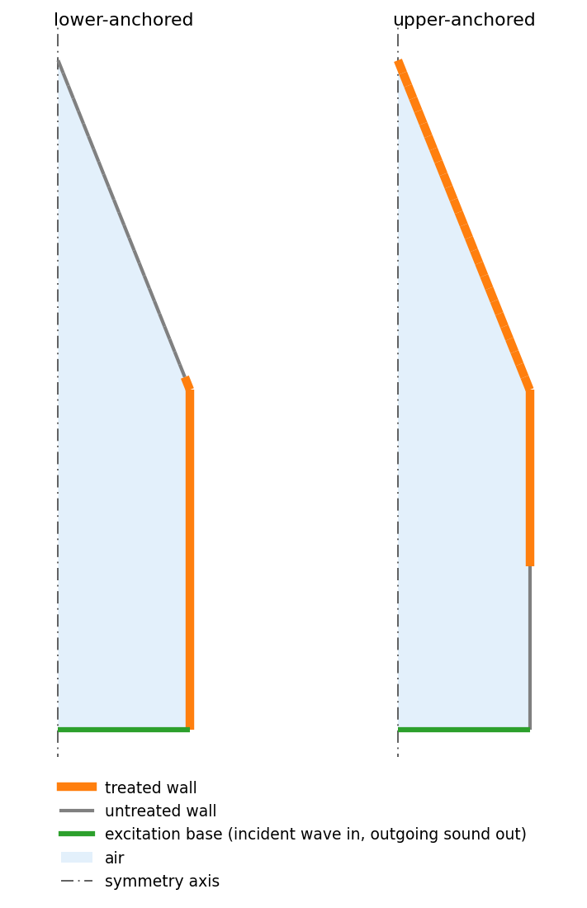
  </a>
  <figcaption><em>Figure 6: Treatment Placement.</em></figcaption>
</figure>

Each placement was evaluated at both the lower and upper background-loss settings, giving four combinations:

- Lower background loss with lower-anchored treatment.
- Lower background loss with upper-anchored treatment.
- Upper background loss with lower-anchored treatment.
- Upper background loss with upper-anchored treatment.

The placement choices move the treated wall region, not individual resonator cells. They are identical when coverage is complete.

For each combination, FEM compared the treated cavity with an untreated reference using the same background-loss setting and calculated an overall reduction. The lowest of the four results became the design’s audit FEM score. Neither the design geometry nor coverage was reoptimized using FEM.

The resulting FEM score was then compared with the reduced-order score for the same unchanged design. Both scores retain the least favorable prediction across prescribed settings, but those settings differ between the models.

The reduced-order score takes the lowest prediction over a prescribed grid of bare-wall absorption values from 0.02 to 0.10 and background-loss values around the condition’s nominal $\kappa$. The FEM audit instead fixes bare-wall absorption at 0.05 and evaluates the background-loss endpoints with both treatment placements. Changing $\kappa$ changes the distributed loss factor $\eta(f)$ defined in Eq. (22). Treatment placement is an additional consideration in FEM because its pressure field varies spatially, whereas the reduced-order model does not resolve placement.

Consequently, differences between the scores can reflect both acoustic formulation and uncertainty treatment. The audit therefore assesses consistency between the two complete evaluation procedures, rather than isolating only the effect of replacing the energy-balance approximation with a spatial acoustic solution.

### 4.3 Agreement and Its Limits

The audit examines whether designs selected using the reduced-order model retain similar predicted benefits when spatial pressure variations are resolved. Comparing the two predictions for each unchanged design shows both the overall relationship and the size of individual discrepancies.

Figure 7 compares the reduced-order and FEM predictions for the same 20 selected designs. Each point represents one design evaluated without further optimization, and $y=x$ indicates equal predictions.

<figure align="center">
  <a href="docs/figures/readme/fig_rom_vs_fem.png">
    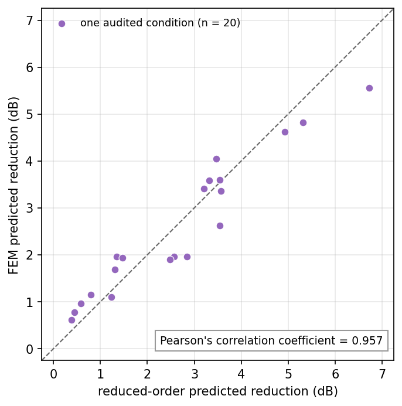
  </a>
  <figcaption><em>Figure 7: Reduced-Order Model Predictions vs FEM Predictions.</em></figcaption>
</figure>

The predictions were strongly correlated ($0.957$), with a median absolute difference of $0.374 \ \mathrm{dB}$ and a maximum of $1.180 \ \mathrm{dB}$. The reduced-order model predicted $0.073 \ \mathrm{dB}$ more reduction on average. This small average offset does not imply uniformly close agreement, as individual differences were larger and occurred in both directions.

These results support consistency between the two evaluation procedures over the tested cases, not experimental validation. Both retain the same assumed linear resonator impedance and damping. The audit also does not establish that the hybrid’s advantage over competing search methods persists under FEM, because only the hybrid’s selected designs were evaluated.

While this comparison supports model-to-model consistency across the tested synthetic conditions, it does not address payload obstruction or amplitude-dependent neck flow. The next section examines these effects in representative Falcon 9 and Atlas I configurations, using FEM with rigid payload geometry and CFD-based impedance corrections.

## 5. Representative Vehicle Applications

The synthetic evaluations test the search method across a controlled family of conditions. The following vehicle studies examine whether generated designs from LinerGen-seeded CMA-ES retain their predicted benefit when published acoustic spectra, rigid payload geometries, and amplitude-dependent neck-flow effects are introduced. 

Two simplified configurations represent Falcon 9 and Atlas I. The Falcon 9 case uses acoustic envelopes from the Falcon's User’s Guide and a simplified fairing geometry informed by its published dimensions ([Falcon's User Guide, Version 8 - March 2025](https://www.spacex.com/assets/media/falcon-users-guide-2025-05-09.pdf)). The Atlas I representative case uses the qualification acoustic spectrum for a 14-ft-class fairing without acoustic blankets, listed in 'General Enviromental Verification Specification', Appendix C, Table C-3 ([GEVS-SE, Rev A - June 1996](https://snebulos.mit.edu/projects/reference/NASA-Generic/GEVS-SE_Rev_A.pdf)). Its simplified fairing geometry is based on dimensions reported in ['Ground Test Program for New Atlas Payload Fairings'](https://ntrs.nasa.gov/api/citations/19910001002/downloads/19910001002.pdf). Both geometries are modeling approximations, not attempted reproductions of the vehicle.

### 5.1 Selected Designs and Mass Constraints

For each vehicle, five independent LinerGen-seeded CMA-ES searches were run with 2,048 evaluations each. The finalist was selected using the reduced-order score defined in Eq. (16) before FEM or CFD evaluation.

Both selected designs use four resonator banks, approximately 50 mm cavity depth, and full modeled wall coverage. The modeled wall areas are 166.6 m² for Falcon 9 and 118.7 m² for Atlas I. Figure 8 shows the idealized cross-section of one cell for each selected bank geometry, where cell width, depth, and necks are to scale. Additionally, the contributions to installed mass relative to each assumed budget shown, where for both vehicles the selected design covered 100% of the wall, while only taking up about 72% (for Falcon 9) and 67% (for Atlas I) of the given mass budget.  

The mass budgets are study assumptions. Atlas’s budget was scaled by wall area to preserve the same allowable mass per unit area as Falcon, which is approximately $2.40 \ kg/m^2$. Additionally, the Falcon 9 mass budget of 400 kg exceeds the 100–300 kg range sampled during training. This application therefore evaluates the trained generator beyond its sampled training range for the mass-budget input.

<figure align="center">
  <a href="docs/figures/readme/fig6_designs_mass.png">
    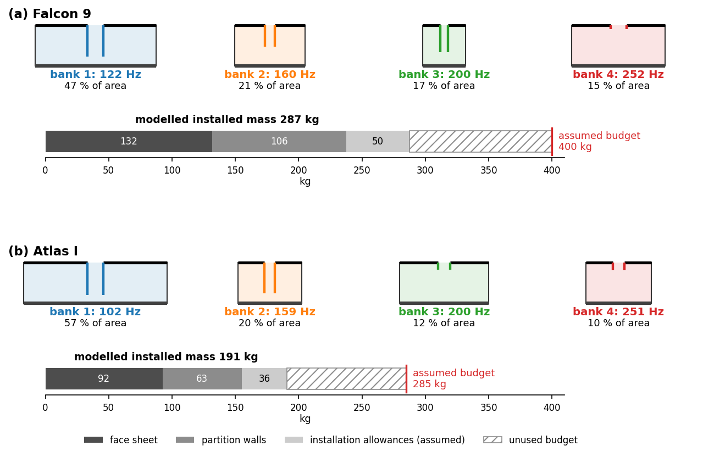
  </a>
  <figcaption><em>Figure 8. Selected four-bank designs and modeled installed-mass breakdowns.</em></figcaption>
</figure>

With the finalist designs selected, the next step was to examine whether their predicted benefits persisted when the acoustic field around a representative payload was resolved. Their geometry and wall coverage were held unchanged, allowing FEM to assess the selected designs without further optimization.

### 5.2 FEM with Representative Payload Geometry

The vehicle FEM uses the acoustic formulation introduced earlier with Eqs. (19)-(21), but adds a rigid payload inside the fairing. Its equivalent axisymmetric geometry removes the occupied region from the air domain, changes the space through which sound propagates, and introduces a rigid reflecting boundary.

The payload surface is treated as acoustically rigid: air cannot move through it. This gives the boundary condition

```math
\frac{\partial p}{\partial n}=0 \qquad (25)
```

where $p$ is complex acoustic pressure and $n$ denotes the direction normal to the surface. The model therefore captures the payload’s obstruction and reflection of sound, but not its structural vibration.

The selected liner’s complex surface impedance is applied to the treated fairing wall, and FEM solves for pressure in the air surrounding the rigid payload. Individual resonator cells are represented through this boundary condition rather than explicitly meshed. An untreated reference is evaluated with the same geometry, incident forcing, and background-loss setting, but with the bare-wall boundary response.

Figure 9 compares the untreated and treated pressure amplitudes at 200 Hz for both representative vehicles. The hatched regions represent rigid payloads excluded from the air domain. All panels share a logarithmic color scale showing pressure amplitude relative to the incident-wave amplitude, where brighter colors indicate higher amplitudes, and darker colors indicate lower amplitudes. The treated fields show lower amplitudes across much of the cavity, together with changes in the spatial pressure pattern. These are predictions using the linear liner impedance, before CFD correction.

<figure align="center">
  <a href="docs/figures/readme/fig7_fem_amplitude_untreated_treated.png" >
    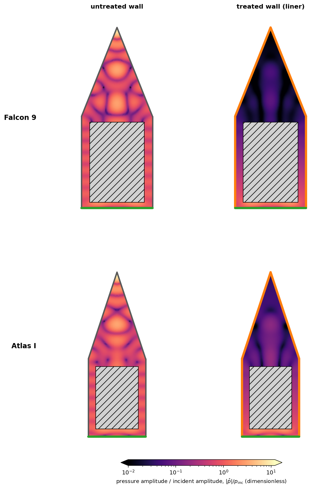
  </a>
  <figcaption><em>Figure 9. Predicted pressure amplitudes at 200 Hz for the representative Falcon 9 and Atlas I configurations, without treatment (left) and with the selected liners (right). Colors show pressure amplitude normalized by the incident amplitude on a shared logarithmic scale. Hatched regions represent rigid payloads excluded from the air domain. Results use the baseline linear liner impedance with Q = 15, before CFD correction.</em></figcaption>
</figure>

To quantify the change across the air domain, rather than at individual locations, the calculation compares the volume-averaged squared pressure amplitudes:

```math
\mathrm{NR}_{b}^{\mathrm{FEM}} = 10\log_{10} \left( \frac{ \left\langle |p_{\mathrm{bare},b}|^2 \right\rangle_V }{ \left\langle |p_{\mathrm{treated},b}|^2 \right\rangle_V } \right) \qquad (26)
```

Here, $\langle\cdot\rangle_V$ denotes averaging over the air volume, and $b$ identifies the evaluated frequency band. For the 200 Hz fields shown in Figure 9, Eq. (26) gives reductions of 5.83 dB for Falcon 9 and 5.36 dB for Atlas I. However, these are single-frequency results. The overall reduction combines all eight evaluated bands using the source-energy weights defined earlier.

Each design was evaluated at nominal FEM mesh sizes of 0.20, 0.15, and 0.10 m to assess how mesh resolution affected the predicted reduction. Differences between these predictions contributed to the numerical allowance used in the conservative vehicle assessment described later in Section 5.5. These comparisons do not establish formal mesh convergence.

The reported reduction is a volume average, not a guarantee of equal improvement at every location around the payload.

### 5.3 CFD for Amplitude-Dependent Neck Flow

The initial FEM retains the search model’s linear impedance and assumed quality factor of $Q=15$. At larger oscillation amplitudes, neck flow can separate and shed vortices, changing resistance and reactance. Local CFD investigates these additional effects using the neck geometry of each selected design.

For each resonator bank, the case-generation code reads the selected neck radius $r_i$, physical neck length $L_i$, and tuning frequency $f_{0,i}$ from the design LinerGen-seeded CMA-ES generated. The radius and length define the circular passage in the CFD mesh, while the tuning frequency sets the oscillation frequency. The modeled passage uses the physical length $L_i$, not the end-corrected acoustic length $L_{\mathrm{eff},i}$.

Separate OpenFOAM cases are generated for each bank over a range of target neck velocities, informed by the vehicle’s source spectrum and the bank’s baseline impedance. Each case isolates the neck passage and its surrounding flow rather than simulating the complete resonator or fairing.

Figure 10 illustrates this translation for Falcon 9 bank 4. Figure 10(a) shows the neck within the idealized resonator cell. Figure 10(b) shows the CFD domain, which retains the neck’s radius and physical length but replaces the surrounding regions with computational reservoirs. These reservoirs are not replicas of the resonator cavity, as cavity compliance remains represented by the baseline acoustic model. Bank area shares and wall coverage likewise enter the later surface-impedance calculation, not this individual neck-flow mesh.

The purple sampling planes measure area-averaged pressure on opposite sides of the neck, while the blue plane measures volume flow through its midpoint. These measurements provide the pressure and flow histories used below to extract impedance.


<figure align="center">
  <a href="docs/figures/readme/fig5-3_cfd_domain.png">
    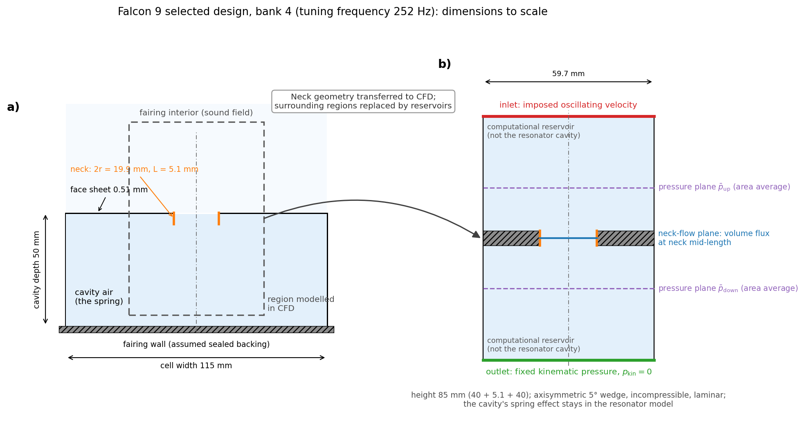
  </a>
  <figcaption><em>Figure 10. Local CFD domain for Falcon 9 bank 4. (a) Idealized resonator cell. (b) Computational reservoirs surrounding the same neck geometry, with pressure-sampling planes in purple and the neck-flow measurement plane in blue. Cavity compliance remains represented by the baseline acoustic model.
</em></figcaption>
</figure>

Within this domain, OpenFOAM’s pimpleFoam solver calculates time-dependent, incompressible flow. Sinusoidal velocity is imposed at the reservoir inlet, solid surfaces enforce no slip, and the outlet fixes kinematic pressure. The mesh is concentrated near the neck walls and openings. The actual neck velocity is measured from the simulated flow rather than assumed equal to its target value.

The solver determines the velocity and pressure fields by enforcing conservation of mass,

```math
\nabla\cdot\mathbf{u}=0 \qquad (27)
```

and momentum,

```math
\frac{\partial\mathbf{u}}{\partial t} + (\mathbf{u}\cdot\nabla)\mathbf{u} = -\frac{1}{\rho}\nabla p_{\mathrm{flow}} + \nu\nabla^2\mathbf{u} \qquad (28)
```

where $\mathbf{u}$ is fluid velocity, $p_{\mathrm{flow}}$ is pressure, and $\nu$ is kinematic viscosity. The laminar formulation includes viscous effects but does not model thermal losses, three-dimensional turbulent motion, or compressible acoustic propagation through the fairing.

OpenFOAM supplies pressure and flow histories, and the project’s post-processing code converts these into impedance. Pressure is averaged over two sampling planes on opposite sides of the neck. Because the incompressible solver stores kinematic pressure, the physical pressure difference is recovered using

```math
\Delta p(t) = \rho \left[ p_{\mathrm{kin,up}}(t) - p_{\mathrm{kin,down}}(t) \right] \qquad (29)
```

The simulated volume flow rate through the neck gives its cross-section-averaged velocity:

```math
u_n(t)=\frac{\dot V(t)}{S_n} \qquad (30)
```

where $\dot V$ is the volume flow rate through the full circular neck and $S_n$ is its opening area. The wedge flow rate is scaled to the full circumference before this calculation.

The code fits sine and cosine components at the forcing frequency to obtain the complex amplitudes of pressure difference and velocity. Their ratio gives the fundamental-frequency impedance:

```math
z_{\mathrm{CFD}} = \frac{\widehat{\Delta p}}{\widehat{u}_n} = R_{\mathrm{CFD}} + \mathrm{i}X_{\mathrm{CFD}} \qquad (31)
```

Here, hats denote complex amplitudes, $R_{\mathrm{CFD}}$ is resistance, and $X_{\mathrm{CFD}}$ is reactance. This pressure-to-velocity impedance has units of $\mathrm{Pa\cdot s/m}$, unlike the cell impedance $Z_a$, which relates pressure to volume flow rate.

The code then checks whether the extracted impedance is suitable for the correction model. It measures harmonic distortion, which is the strength of oscillations at multiples of the forcing frequency, then compares alternative impedance calculations, and checks variation between analysis windows. Estimates must satisfy the prescribed acceptance criteria before use. Section 5.5 discusses the stability checks and subsequent follow-ups.

The accepted estimates supply the amplitude-dependent corrections described next. CFD does not directly predict the fairing’s noise reduction, as the corrected liner impedance must first be incorporated into the acoustic FEM.

These checks determine which local neck-flow estimates can support the acoustic correction. The accepted estimates are then incorporated into the liner model and FEM is recalculated in order to establish a change in fairing case noise reduction. 

### 5.4 From Local CFD to Corrected FEM Predictions

To examine how amplitude-dependent neck flow changes the predicted acoustic benefit, the accepted CFD results are used to update the liner impedance supplied to FEM. The selected geometry and wall coverage remain unchanged, so this evaluation tests the existing designs rather than optimizing new ones.

The correction involves two connected calculations. First, each bank’s resistance and reactance changes are measured relative to its low-amplitude CFD reference. Using these differences, rather than the full CFD impedance, preserves the baseline resonator model while adding the modeled amplitude-dependent effects. Second, the calculation determines which correction applies under the prescribed acoustic forcing. This requires finding a consistent operating velocity, because neck velocity affects impedance and impedance in turn affects neck velocity.

For each bank, the additional resistance relative to the validated low-amplitude reference is

```math
\Delta R_i(U) = \max\left[ 0,\, R_{\mathrm{CFD},i}(U)-R_{\mathrm{ref},i} \right] \qquad (32)
```

The corresponding reactance change is represented as an additional inertance:

```math
\Delta M_i(U) = \frac{ X_{\mathrm{CFD},i}(U)-X_{\mathrm{ref},i} }{ \omega_{0,i} } \qquad (33)
```

Here, $U$ is neck-velocity amplitude and $\omega_{0,i}=2\pi f_{0,i}$. Subtracting the low-amplitude reference isolates the modeled amplitude-dependent change while retaining the baseline damping assumption of $Q=15$. It does not experimentally calibrate that assumption.

These corrections describe a range of velocities, but the FEM boundary requires a correction evaluated at the bank’s operating point. The calculation therefore finds the velocity $U_i^*$ at which the corrected impedance and prescribed forcing pressure satisfy

```math
U_i^* \left| S_{n,i}Z_{a,i}^{\mathrm{linear}}(\omega_{0,i}) + \Delta R_i(U_i^*) + \mathrm{i}\omega_{0,i}\Delta M_i(U_i^*) \right| = p_{\mathrm{peak},i} \qquad (34)
```

Here, $p_{\mathrm{peak},i}$ is the prescribed forcing-pressure amplitude associated with the bank’s tuning frequency. The expression inside the magnitude is the corrected pressure-to-neck-velocity impedance.

Two prescribed forcing assumptions are considered: broadband-equivalent forcing and resonant-tone forcing. Unlike the linear reduced-order score, this calculation depends on absolute source level because stronger forcing can produce larger neck velocities and different impedance corrections. CFD-corrected operating points must lie within the supported CFD velocity range and pass the required checks.

Figure 11 shows how the CFD correction changes the predicted neck response for Falcon 9 bank 4. Under the same prescribed peak pressure of 84.4 Pa, the linear model predicts a neck velocity of approximately 30.2 m/s, whereas the corrected model predicts 9.3 m/s. In this case, the amplitude-dependent changes increase the effective impedance, so the same pressure drives less neck motion than the linear model predicts. This operating velocity determines which correction is incorporated into the liner model, but the resulting change in noise reduction must still be calculated using FEM.

<figure align="center">
  <a href="docs/figures/readme/fig5-4_operating_velocity.png">
    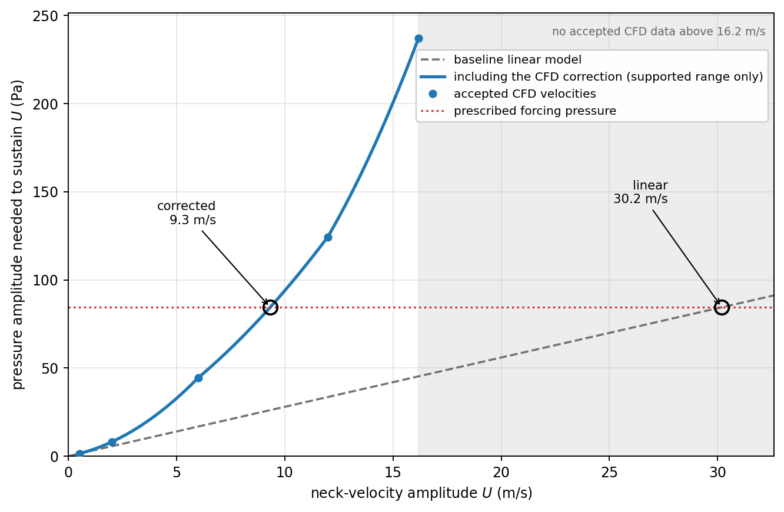
  </a>
  <figcaption><em>Figure 11. Operating neck velocity for one bank (Falcon 9 selected design, bank 4, 252 Hz) under resonant-tone forcing (sound pressure level 129.5 dB, peak pressure 84.4 Pa).</em></figcaption>
</figure>

At the accepted operating velocity, the corrected cell impedance becomes

```math
Z_{a,i}^{\mathrm{corrected}}(\omega) = Z_{a,i}^{\mathrm{linear}}(\omega) + \frac{ \Delta R_i(U_i^*) + \mathrm{i}\omega\Delta M_i(U_i^*) }{ S_{n,i} } \qquad (35)
```

Dividing by neck area converts the CFD correction from pressure per velocity to the cell model’s pressure-per-volume-flow convention. Representing the reactance correction as $\omega\Delta M_i$ extends it across the evaluated frequencies. This is a modeling assumption rather than a CFD measurement at every frequency.

The corrected cell impedances are combined using the same cell-density-weighted admittance calculation introduced earlier. The resulting surface impedance replaces the linear liner boundary in FEM. FEM then recalculates the spatial pressure field, band reductions, and source-energy-weighted overall reduction without changing the selected design.

### 5.5 Numerical Sensitivity and Vehicle Outcomes

The design search selects resonator tuning, geometry, and area allocation within prescribed mass and depth constraints. The final assessment examines whether the selected designs retain their predicted low-frequency benefit when amplitude-dependent neck flow and numerical uncertainty are included. Their geometry and wall coverage remain unchanged throughout this assessment.

This requires distinguishing the reduction predicted by the models from the numerical evidence supporting that prediction. The assessment therefore considers three sources separately: statistical uncertainty in the extracted CFD impedance, sensitivity to CFD mesh and time-step settings, and sensitivity to the FEM mesh.

Statistical uncertainty arises from variation between simulated cycles. In the statistical follow-ups, this uncertainty was propagated through five impedance tables: the central table and four joint combinations of lower and upper resistance and reactance estimates. Each non-reference point was shifted by its corresponding 95% confidence-interval half-width, while the low-amplitude reference remained unchanged. Operating velocities and corrected FEM predictions were recalculated for each table under both forcing assumptions.

These calculations examine uncertainty in the extracted estimates. To assess sensitivity to the numerical settings themselves, additional CFD cases changed the mesh and time-step control while retaining the physical geometry and imposed forcing.

Rather than repeat every simulation, these comparisons focused on a controlling bank. The forcing assumption producing the lower corrected FEM prediction was selected first. Each bank’s correction was then applied individually, and the bank producing the largest absolute change from the linear-impedance FEM prediction was selected for further checks.

Three velocities were chosen from that bank’s validated sweep: a low velocity, the velocity nearest its estimated operating point $U^*$, and a high velocity. Two types of checks produced five simulation variants:

- **Mesh refinement:** radial and axial cell counts were doubled at the low and near-operating velocities, giving two variants.
- **Time-step sensitivity:** the maximum Courant number was reduced from 0.5 to 0.25 at all three velocities, giving three variants.

Each variant was compared with its corresponding nominal case. Resistance and reactance differences were normalized by the nominal impedance magnitude:

```math
e_R = \max_{c\in\mathcal{C}} \frac{ \left|R_c^{\mathrm{variant}}-R_c^{\mathrm{nominal}}\right| }{ \left|z_c^{\mathrm{nominal}}\right| }, \qquad e_X = \max_{c\in\mathcal{C}} \frac{ \left|X_c^{\mathrm{variant}}-X_c^{\mathrm{nominal}}\right| }{ \left|z_c^{\mathrm{nominal}}\right| } \qquad (36)
```

Here, $\mathcal{C}$ is the prescribed set of five comparisons. Normalization by the full impedance magnitude avoids dividing by a resistance or reactance component that may be close to zero. Both members of each comparison must provide usable estimates before a complete sensitivity allowance can be established.

Where these requirements were satisfied, the largest observed changes defined an empirical sensitivity envelope. Resistance and reactance were perturbed in four joint sign combinations, leaving the low-amplitude reference unchanged. Recalculating operating velocities and corrected FEM predictions then supplied the CFD numerical-sensitivity allowance.

Extending this envelope to untested banks and velocities assumes that they are no more numerically sensitive than the tested cases. It is not a proven global error bound. High-speed mesh sensitivity and combined mesh/time-step effects were not established.

The acoustic calculation introduces a separate dependence on FEM mesh resolution. Corrected predictions were evaluated at nominal mesh sizes of 0.20, 0.15, and 0.10 m. Each coarser-mesh prediction was compared with its corresponding 0.10 m result, and the largest absolute difference defined the FEM mesh allowance. These comparisons provide sensitivity evidence, not formal mesh convergence.

The three assessments were then combined. When the required calculations completed, the conservative lower estimate was obtained by taking the lowest 0.10 m prediction across the five impedance tables and both forcing assumptions, then subtracting the FEM mesh allowance and the downward CFD numerical-sensitivity allowance.

A formal PASS required this lower estimate to exceed the retained internal benchmark of 0.9213 dB, with all given checks passed. This benchmark came from an earlier study as 60% of a model-based reference-liner estimate of 1.5355 dB. However, favorable predicted reduction alone was insufficient if impedance estimates, operating points, or uncertainty calculations remained unsupported.

Both vehicle studies were initially unresolved because required parts of this assessment could not be completed. Later follow-ups investigated the remaining obstacles. These follow-ups were designed after the earlier results were known, but each protocol was fixed before its new simulations or calculations began. Earlier outcomes were retained rather than replaced.

<table align="center">
  <caption>
    <em>Table 6. Vehicle outcomes after the separately declared follow-ups.</em>
  </caption>
  <thead>
    <tr>
      <th align="left">Vehicle</th>
      <th align="left">Follow-up finding</th>
      <th align="left">Interpretation</th>
    </tr>
  </thead>
  <tbody>
    <tr>
      <td>Atlas I</td>
      <td>
        Longer runs at two high-speed impedance points allowed the required
        uncertainty calculations to complete. The conservative lower estimate
        was 2.352 dB, exceeding the target.
      </td>
      <td>
        <strong>PASS in the follow-up</strong>, for the primary source and
        payload configuration.
      </td>
    </tr>
    <tr>
      <td>Falcon 9</td>
      <td>
        A longer-domain diagnostic and a fresh pair of runs with 100 analyzed
        cycles did not resolve every required stability check. A subsequent
        pessimistic sensitivity bound could not be propagated through the
        correction method.
      </td>
      <td>
        <strong>UNRESOLVED</strong>; no complete conservative interval
        was established.
      </td>
    </tr>
  </tbody>
</table>

For Atlas I, the lowest fine-mesh prediction across the impedance uncertainty tables and forcing assumptions was 2.3624 dB. Subtracting the FEM mesh allowance of 0.00236 dB and the CFD numerical-sensitivity allowance of 0.00813 dB gave the conservative lower estimate of 2.3519 dB. The prescribed numerical allowances therefore had a small effect on this result.

For Falcon 9, completed CFD-corrected FEM predictions were approximately 3.54–3.65 dB for the primary configuration across the evaluated impedance tables and forcing assumptions. These favorable predictions do not replace the incomplete sensitivity evidence. UNRESOLVED means that the required evidence was insufficient to confirm the outcome—not that performance below the target was demonstrated.

Figure 12 shows how the predicted benefit changes across the modeling chain for the same selected designs. The CFD correction lowers the linear-impedance FEM prediction by approximately 0.34–0.44 dB for Falcon 9, while the change for Atlas I is approximately 0.02 dB. Both retain positive predicted reductions, but the bars alone do not establish the vehicle outcomes: Atlas’s pass depends on the completed conservative assessment, while Falcon’s remains incomplete.

<figure align="center">
  <a href="docs/figures/readme/fig8_vehicle_chain.png">
    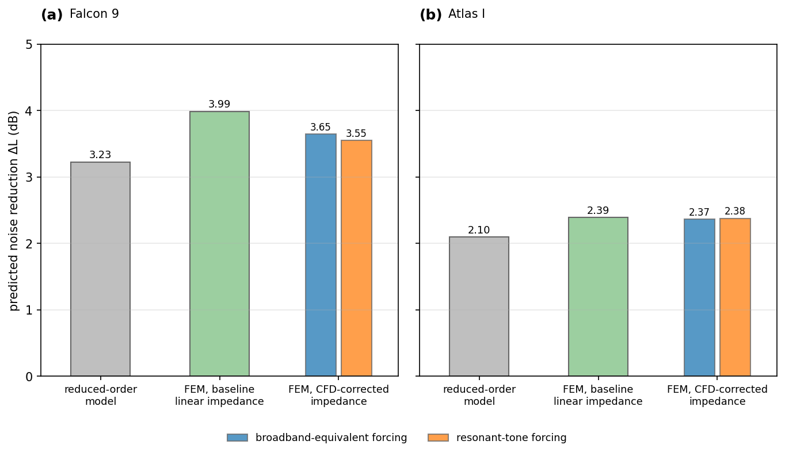
  </a>
  <figcaption><em>Figure 12. Predicted noise reduction for the selected designs under the reduced-order model, linear-impedance FEM, and CFD-corrected FEM. FEM results use the 0.10 m mesh and each vehicle’s primary source and payload configuration. Blue and orange bars distinguish the two forcing assumptions. CFD-corrected bars use the central impedance table; impedance uncertainty and final numerical allowances are not shown.</em></figcaption>
</figure>

The selected designs retained favorable predicted acoustic benefits after amplitude-dependent neck-flow corrections, without changing their geometry, wall coverage, or modeled installed mass. Atlas I completed the prescribed uncertainty and numerical assessment, giving a conservative lower estimate of 2.35 dB. Falcon 9 produced favorable corrected predictions, but incomplete sensitivity evidence prevented a complete conservative assessment.

## 6. Conclusions, Limitations, and Next Steps 

### 6.1 Conclusions

This project developed and evaluated a physics-guided workflow for designing four-bank Helmholtz acoustic liners under prescribed mass and geometry constraints. LinerGen supplied learned starting designs, CMA-ES refined them using a reduced-order acoustic score, and FEM and local CFD examined selected designs beyond the model used for search.

Controlled comparisons evaluated the benefit of these learned starting designs under matched search budgets. FEM and local CFD subsequently examined selected designs using spatial acoustic fields, representative payload geometry, and amplitude-dependent neck-flow corrections. The representative Atlas I design completed the prescribed corrected-FEM and uncertainty assessment. Falcon 9 also produced favorable corrected predictions, but unresolved numerical checks prevented a complete conservative assessment.

Launch-vehicle acoustic treatments, must address low-frequency noise without consuming excessive mass or payload space. For Helmholtz liners, this requires coordinating resonator tuning, geometry, and area allocation rather than optimizing individual cells in isolation. This project demonstrates a computational approach to exploring those choices and assessing the resulting designs, while experimental testing and matched comparisons remain necessary to establish practical advantages over existing treatments.

### 6.2 Limitations

The demonstrated search advantage applies to the reduced-order score within the chosen four-bank design space. Although selected designs were subsequently evaluated using FEM, competing methods’ selected designs were not evaluated alongside them. The study therefore does not establish that the same advantage persists under spatial acoustic modeling or experimental testing.

Adding FEM and CFD increases modeling detail without removing every underlying assumption. The reduced-order model and FEM share the baseline resonator impedance and assumed damping, so agreement between them indicates consistency rather than independent validation. The fairing and payload geometries are representative and axisymmetric, while the local CFD simulations resolve individual neck flow rather than the complete resonator array. These models do not capture all three-dimensional, structural, or loss mechanisms, and the numerical checks do not establish global convergence.

The practical mass and space implications also remain conditional on the study assumptions. Installed mass is estimated using a simplified construction model, and the vehicle budgets are not manufacturer requirements. Both finalists achieved full coverage below their budgets, so these examples do not establish minimum-mass solutions or show how performance changes as constraints tighten. Without manufactured components, acoustic measurements, and matched comparisons with existing treatments, the predicted benefits cannot yet be translated into demonstrated hardware advantages.

### 6.3 Next Steps

The controlled search results motivate evaluating whether the benefit of learned initialization persists beyond the reduced-order model. A direct extension would compare designs selected by LinerGen-seeded CMA-ES and the search baselines using the same FEM conditions. Because most of the observed improvement came from the learned proposals, this comparison should also retain the proposals-only method to assess whether evolutionary refinement provides additional benefit under spatial acoustic modeling.

The shared impedance assumptions make experimental characterization another priority. Measurements of representative cells and liner patches would allow the assumed damping and amplitude-dependent corrections to be assessed against observed behavior. For Falcon 9, the unresolved numerical checks should first be investigated to determine whether longer sampling or changes in model fidelity are justified. Moving to three-dimensional simulations alone would not resolve the existing uncertainty.

A longer-term extension would translate the generated geometries into manufacturable liner specimens for physical testing. This would require selecting materials, detailing the necks, partitions, backing, and attachment system, and incorporating their actual mass and dimensional limits into the design model. Testing representative liner patches would then establish whether the predicted absorption and amplitude-dependent response are reproduced in hardware. The measured properties could feed back into the acoustic model, allowing the same design workflow to optimize candidates under experimentally grounded mass and geometry constraints.

  ## 7. How to Run
  
  ### 7.1 Install
  The package declares compatibility with Python 3.11–3.12; the Python workflows were tested with Python 3.11.9 on
  Windows. OpenFOAM (through WSL2 or native Linux) is needed only for the CFD stages, see `environment-openfoam.md`.

  ```powershell
  git clone https://github.com/joshua-s-tan/physics-guided-acoustic-liners.git
  cd physics-guided-acoustic-liners
  python -m venv .venv
  .\.venv\Scripts\Activate.ps1          # Linux/macOS: source .venv/bin/activate
  python -m pip install -r requirements.lock
  python -m pip install -e . --no-deps
  ```

  ### 7.2 Verify the Published Evidence
  The following command checks the published evidence files and recomputes their reported summaries without
  downloading the checkpoint or rerunning simulations. It verifies the saved results, not an independent reproduction
  of the underlying calculations.

  ```powershell
  acoustic-liner verify public
  ```

  To run the public test suite:

  ```powershell
  python -m pip install -r requirements-dev.txt
  python -m pytest -q
  ```

  The test suite took about 50 minutes on one Windows workstation. Six optional tests that need the private
  full-evidence archive are skipped in a public clone.

  ### 7.3 Get the Trained LinerGen Checkpoint
  Download `linergen-v1-selected.pt` from https://github.com/joshua-s-tan/physics-guided-acoustic-liners/releases/tag/v1.0.0, save it as
  `artifacts/dev/physgen_v1/train/selected.pt`, then check it:

  ```powershell
  acoustic-liner provenance checkpoint --full
  ```

  ### 7.4 Rerun the Search Evaluation and FEM Audit
  New pilot, development, and final evaluation records are kept separately from the published records. Existing
  evaluation records are not overwritten. Each split opens only after the previous one has a complete record whose
  gates pass.

  ```powershell
  $linerCheckpoint = "artifacts/dev/physgen_v1/train/selected.pt"

  acoustic-liner evaluation study freeze-splits

  acoustic-liner evaluation study smoke --checkpoint $linerCheckpoint

  acoustic-liner evaluation study evaluate --split pilot_physgen_v1 --checkpoint $linerCheckpoint

  acoustic-liner evaluation study evaluate --split development_physgen_v1 --checkpoint $linerCheckpoint
  ```

  The final split runs only in shards, even on one machine. The commands below run its two shards one after the
  other. Running them in parallel needs two separate terminals and enough CPU for both, and does not automatically
  halve the time.

  ```powershell
  $finalManifest = "artifacts/repro/physgen_v1/shards/final_physgen_v1_manifest.json"
  $finalShard0 = "artifacts/repro/physgen_v1/shards/final_0"
  $finalShard1 = "artifacts/repro/physgen_v1/shards/final_1"

  acoustic-liner evaluation shards manifest --split final_physgen_v1 --checkpoint $linerCheckpoint

  acoustic-liner evaluation shards run --manifest $finalManifest --shard 0 --checkpoint $linerCheckpoint --out $finalShard0

  acoustic-liner evaluation shards run --manifest $finalManifest --shard 1 --checkpoint $linerCheckpoint --out $finalShard1

  acoustic-liner evaluation shards merge --manifest $finalManifest --records $finalShard0 $finalShard1 --out artifacts/repro/physgen_v1/final_physgen_v1.json
  ```

  The commands above use PowerShell variables. On Linux or macOS, set them as `linerCheckpoint="..."` and use them as
  `"$linerCheckpoint"`.

  The FEM transfer audit:

  ```powershell
  acoustic-liner fem transfer-audit run
  ```

  ### 7.5 Repository Layout
  ```
  src/acoustic_liner/
    physics/        resonator impedance, absorption, mass, launch spectra, reduced-order model
    design/         design schema, constraints, operating conditions
    models/         LinerGen generator, training objective, checkpoint loading
    optimization/   multi-start CMA-ES and LinerGen-seeded CMA-ES
    evaluation/     condition splits, study driver, statistics, shards
    fem/            axisymmetric fairing FEM and the transfer audit
    cfd/            OpenFOAM neck-flow cases and post-processing
    vehicles/       vehicle scenarios, finalist search, FEM and CFD orchestration
    visualization/  figure code
    provenance/     hashing, records, checkpoint manifest, verifiers
  evidence/         published results and their hashes
  ```